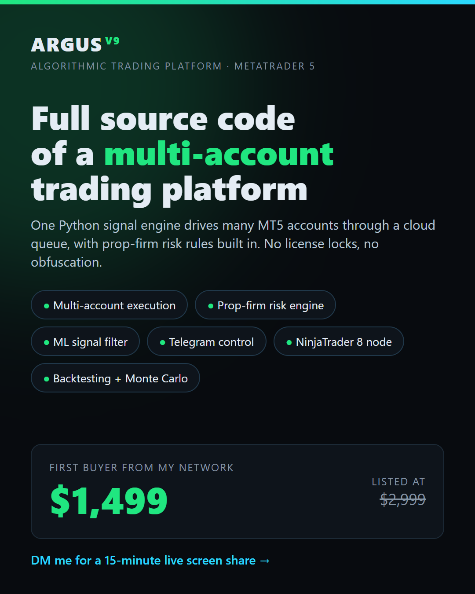
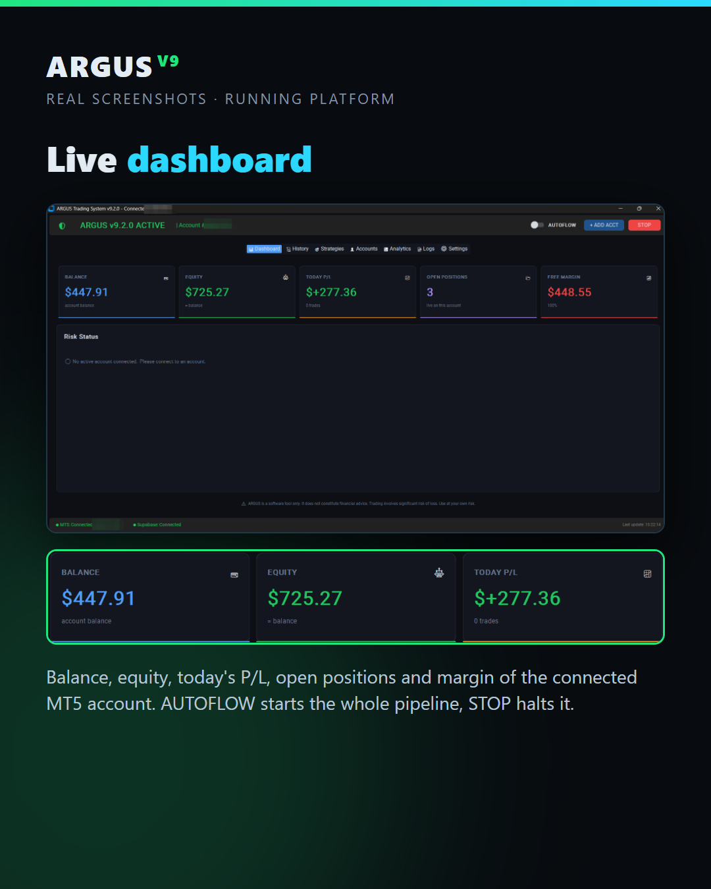
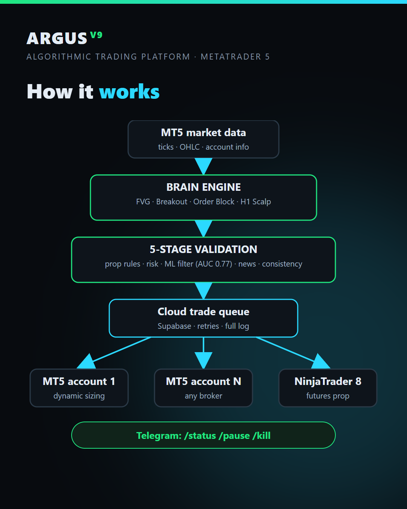
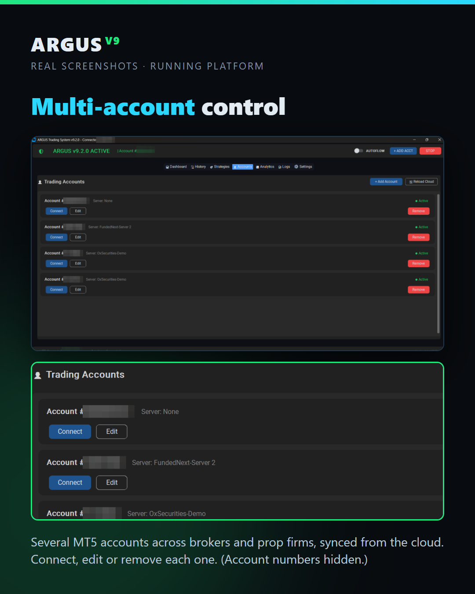
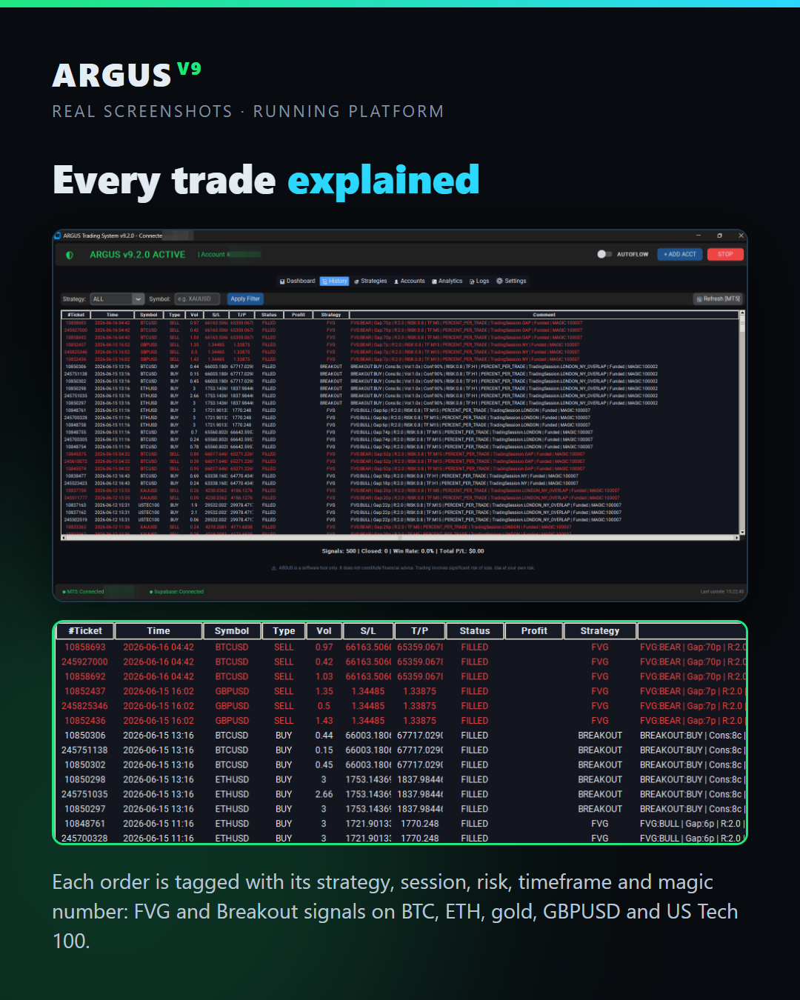
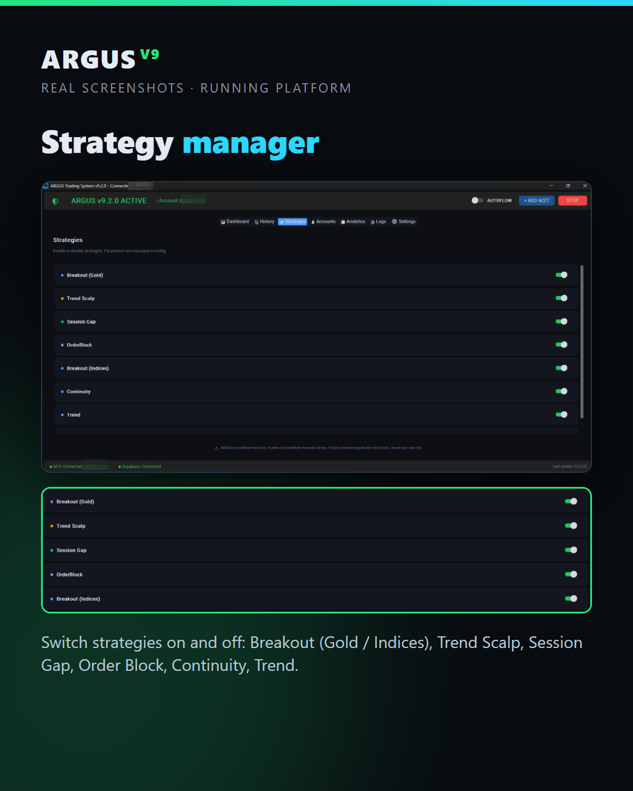
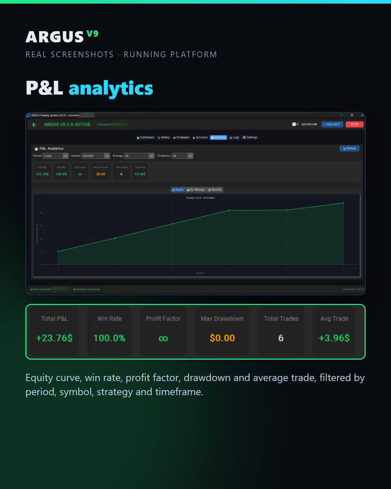
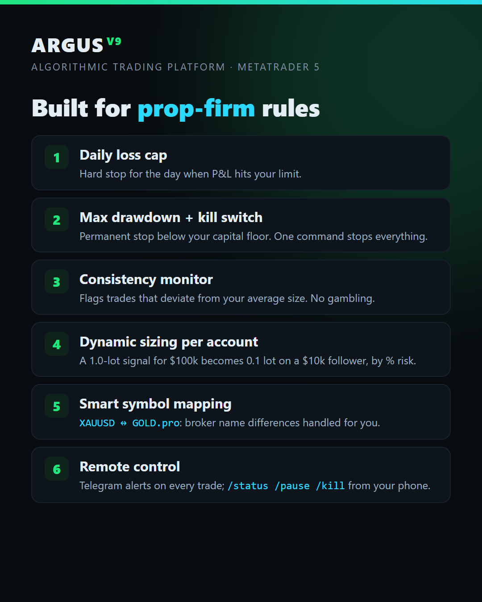
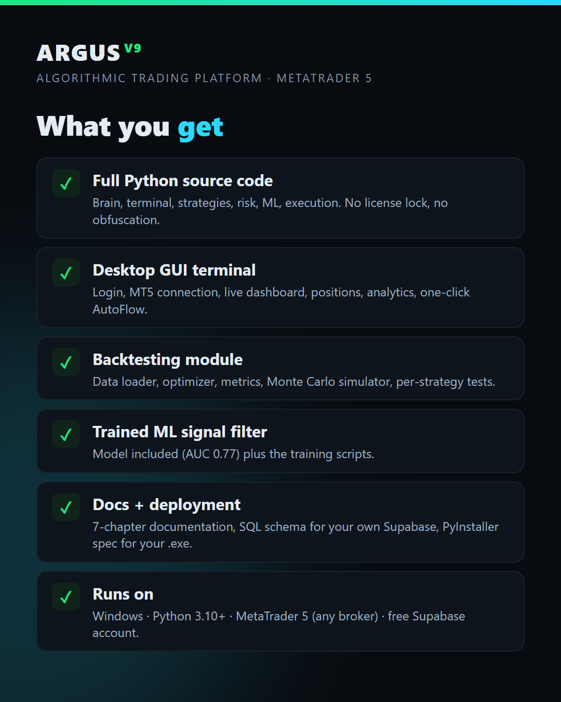

# ARGUS V9: algorithmic trading platform for MetaTrader 5

ARGUS is a Python platform I built over eight months to run strategies on several MetaTrader 5 accounts at once, with prop-firm risk rules on every signal. One "brain" analyses the market, every signal goes through five checks, and executors on any number of accounts (and NinjaTrader 8 futures accounts) place the trades.

This repository is the public showcase: screenshots, the full documentation, and two modules you can use on their own. The complete source code is sold separately.

**Full source code (terminal, brain, strategies, ML model, multi-account engine, backtesting): [ARGUS V9 on Gumroad](https://simplaitech.gumroad.com/l/argus-v9)**

## What it does

- **ARGUS Terminal.** A dark desktop GUI: login, MT5 connection, live dashboard, history, strategies, accounts, analytics, logs and settings. One "AutoFlow" switch starts the whole pipeline.
- **Brain engine.** Scans BTCUSD, ETHUSD, NAS100, XAUUSD, EURUSD, GBPUSD and USDJPY every 30 seconds. Bundled strategies: Fair Value Gap, volume-confirmed Breakout, Order Block re-test, H1 Scalp, Session Gap.
- **Five-stage signal validation.** Prop-firm contract (daily loss cap, max drawdown, trade frequency), risk engine (position sizing), ML filter (model included, AUC 0.77), news guard, consistency monitor.
- **Multi-account execution.** One brain feeds any number of MT5 accounts through a Supabase queue. Brain and executors can run on different machines; sizing and broker symbol names are mapped per account.
- **NinjaTrader 8 node.** The same signals go to NinjaTrader 8 futures accounts through a file-based ATI bridge and a NinjaScript listener. That bridge is open source here.
- **Telegram.** An alert on every trade, plus remote `/status`, `/pause`, `/kill`.
- **Backtesting.** Data loader, optimizer, metrics, Monte Carlo simulator, per-strategy tests.

| | |
|---|---|
|  |  |
|  |  |

## Open-source parts in this repo

| Path | What it is |
|---|---|
| [`ninja_ati/`](ninja_ati) | NinjaTrader 8 bridge: `ati_bridge.py` writes orders as files, `ARGUSListener.cs` (NinjaScript) executes them and reports status back, `risk_manager.py` sizes futures positions by tick value. Works without the rest of ARGUS. |
| [`utils/metrics.py`](utils/metrics.py) | Trading performance metrics: profit factor, drawdown, Sharpe, win rate and more, from a list of trades. |
| [`docs/`](docs) | All 8 chapters of the ARGUS manual: overview, signal pipeline, strategies and portfolio, multi-account, setup, risk management, FAQ, NinjaTrader and ML retraining. |

These parts are MIT-licensed (see `LICENSE`). The rest of ARGUS is not in this repository.

## Honest note on results

The bundled strategies are working examples, not a promise of profit. The value is the infrastructure: risk rules, multi-account execution, the NinjaTrader bridge and the ML filter you can retrain on your own strategies. Trading involves a substantial risk of loss.

## Get the full platform

[ARGUS V9 full source code on Gumroad](https://simplaitech.gumroad.com/l/argus-v9): no obfuscation, no licence locks. Setup guide included, about an hour to the first run. Needs Windows, Python 3.10+, MetaTrader 5 (any broker) and a free Supabase account.

Questions before buying: open an issue in this repository.

